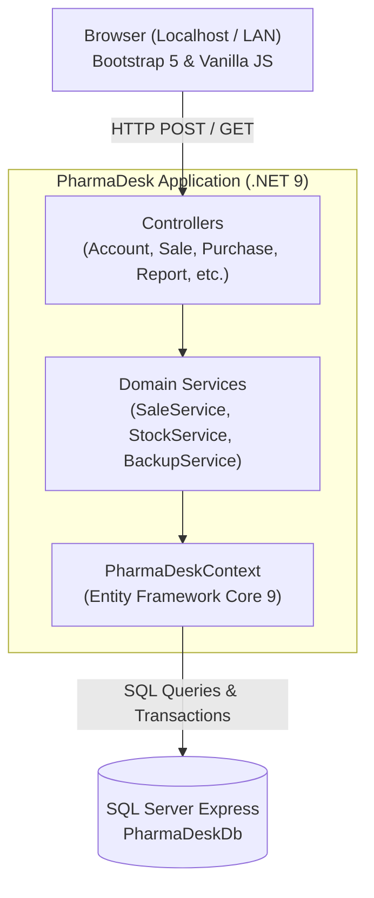

# 03. Architecture & Request Flow

PharmaDesk is built as a single, lightweight ASP.NET Core MVC monolithic desktop web app running on localhost with SQL Server Express.

---

## 🏛️ System Architecture



---

## 📂 Project Structure

```
PharmaDesk/
├── Controllers/         # MVC Controllers handling HTTP requests
├── Data/                # DbContext, DbSeeder, EF Core model configuration
├── Migrations/          # EF Core Code-First migrations
├── Models/              # 10 core domain entities
├── Services/            # Business logic (SaleService, StockService, BackupService)
├── ViewModels/          # Clean models for Razor views & JSON requests
├── Views/               # Razor HTML templates (.cshtml)
│   ├── Shared/_Layout.cshtml   # App shell & sidebar navigation
│   └── [Feature]/...           # Views per feature
└── wwwroot/             # 100% offline local static files (Bootstrap, CSS, JS)
```

---

## ⚡ POS Sale Request Flow

When a cashier clicks **"Complete Sale"**:
1. `SaleController.New (POST)` receives the cart JSON with quantities.
2. `SaleService.ProcessSaleAsync`:
   - Opens **one atomic database transaction** (`BeginTransactionAsync`).
   - Verifies stock and allocates batches using **FEFO** (earliest expiry first).
   - Deducts batch quantities and increments sale lines.
   - Snapshots current selling price in `SaleItems.UnitPrice`.
   - Generates receipt number (`REC-YYYYMMDD-####`).
   - Appends audit entry to `ActivityLog`.
   - Calls `SaveChangesAsync()` and commits transaction.
3. Controller redirects to `/Sale/Details/{id}` to display the printable receipt.
