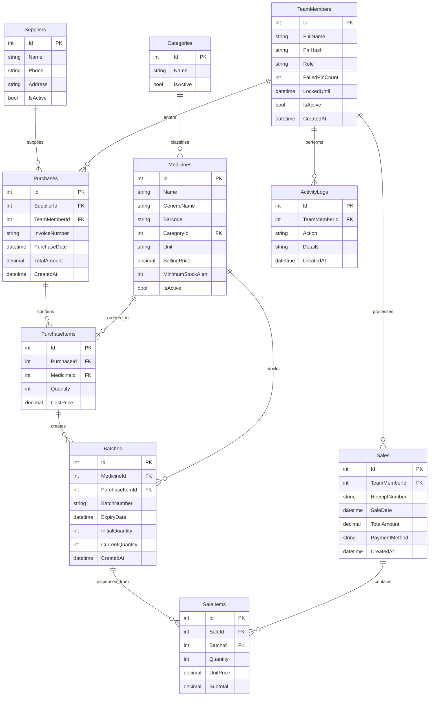

# 04. Data Model & Database Dictionary

The database consists of **10 tables** in SQL Server. Stock balance is tracked strictly at the **Batch** level.

---

## 📊 Entity-Relationship Diagram

---

## 🗃️ Table Breakdown

### 1. `Medicines` & `Categories`
- **Medicines**: Tracks catalog items. `Barcode` is unique. `MinimumStockAlert` triggers warning badges. Soft-deleted via `IsActive = false`.
- **Categories**: Classifies medicines. Unique name index.

### 2. `Suppliers`, `Purchases`, & `PurchaseItems`
- **Suppliers**: Vendors and contact information. Soft-deleted via `IsActive = false`.
- **Purchases**: Header for supplier invoices. Stores total amount and invoice number.
- **PurchaseItems**: Line items in an invoice. `CostPrice` is the cost per single unit.

### 3. `Batches` (The Core Inventory Ledger)
- Every physical box/bottle belongs to a `Batch`.
- `ExpiryDate`: Used for FEFO sorting.
- `CurrentQuantity`: Decrements on sale. Cannot drop below 0.
- **Total Stock Calculation**:
  $$\text{Total Available Stock} = \sum (\text{CurrentQuantity of non-expired batches for this medicine})$$

### 4. `Sales` & `SaleItems`
- **Sales**: Checkout transaction. `ReceiptNumber` formatted as `REC-YYYYMMDD-####`.
- **SaleItems**: Line items in a sale. Always references the specific `BatchId` it was deducted from. `UnitPrice` snapshots the selling price at checkout time.

### 5. `TeamMembers` & `ActivityLogs`
- **TeamMembers**: Users with 4-digit PINs. `Role` is either `Admin` or `Staff`. Tracks failed PIN attempts and lockout time.
- **ActivityLogs**: Append-only log recording logins, sales, purchases, price changes, and backups.

---

## 🔒 Foreign Key Delete Rules

- **Restrict**: Applied to master tables (`Medicines`, `Categories`, `Suppliers`, `TeamMembers`, `Batches`). Cannot delete a category if medicines exist; cannot delete a medicine if batches or sales exist.
- **Cascade**: Applied only to line items (`PurchaseItems` when a `Purchase` is removed, `SaleItems` when a `Sale` is removed).
