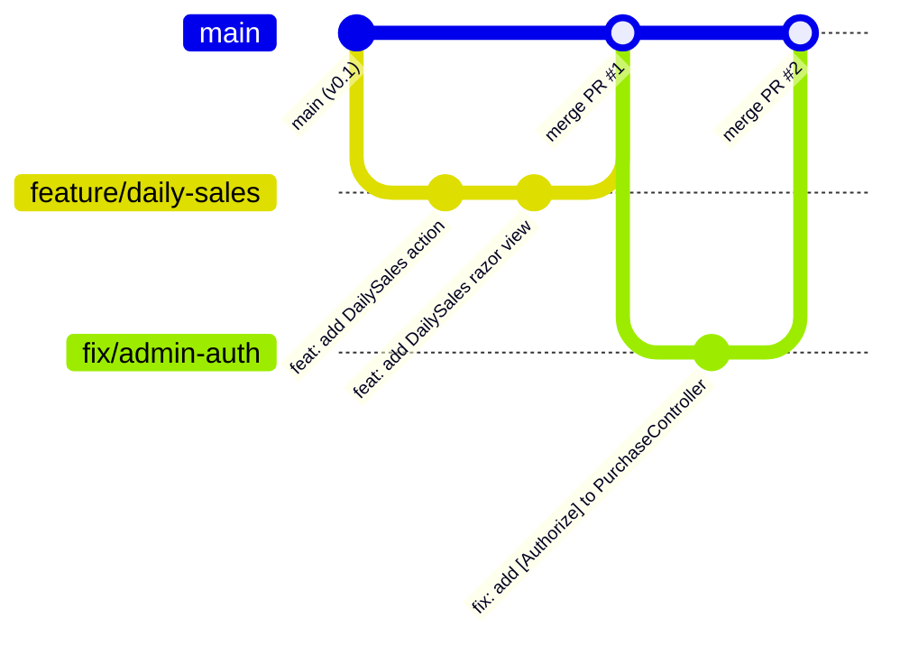

# 08. Development Workflow

A clean, lightweight workflow for **Abdulrahman** and **Ziad** working on a shared repository.

---

## 🌿 Branching Strategy

- **`main`**: Always clean, working, and buildable (`dotnet build` = 0 errors).
- **Feature Branches**: Branch out from `main`:
  - `feature/task-name` for new screens or services.
  - `fix/bug-name` for bug fixes and security patches.

---

## 📝 Commit Conventions

Keep commits clear and simple:
- `feat:` for new features (e.g. `feat: add daily sales report`)
- `fix:` for bug fixes (e.g. `fix: add authorize to purchase controller`)
- `docs:` for documentation updates
- `chore:` for cleanups and config updates

---

## ✅ PR Checklist Before Merging

- [ ] `dotnet build PharmaDesk/PharmaDesk.csproj` compiles with 0 errors and 0 warnings.
- [ ] No hardcoded cashier IDs (`TeamMemberId = 1`).
- [ ] Admin actions have `[Authorize(Roles = "Admin")]`.
- [ ] No plaintext passwords or secrets committed.
